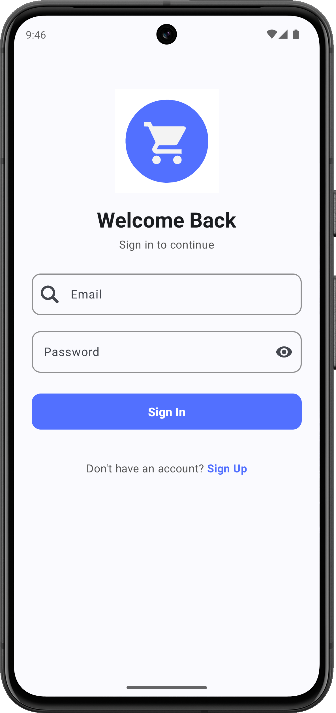
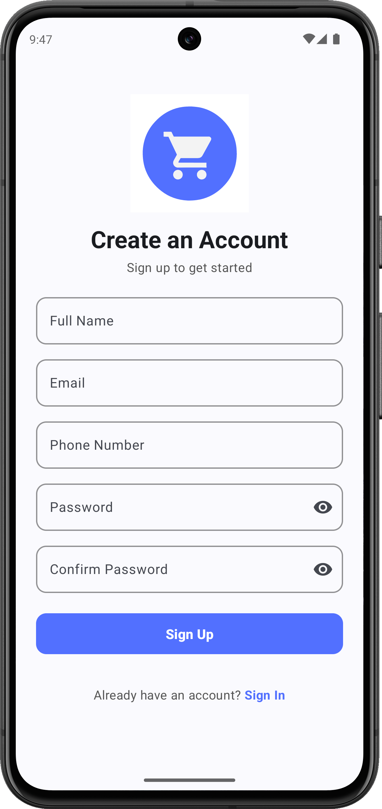
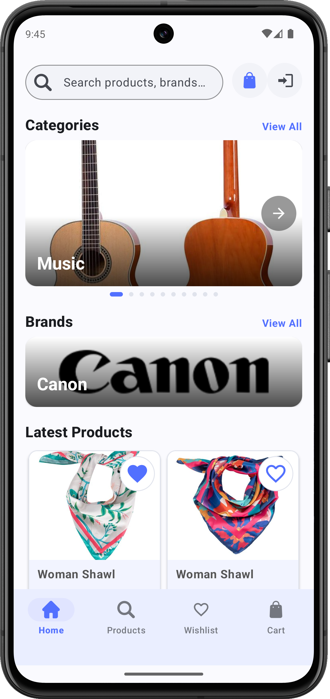
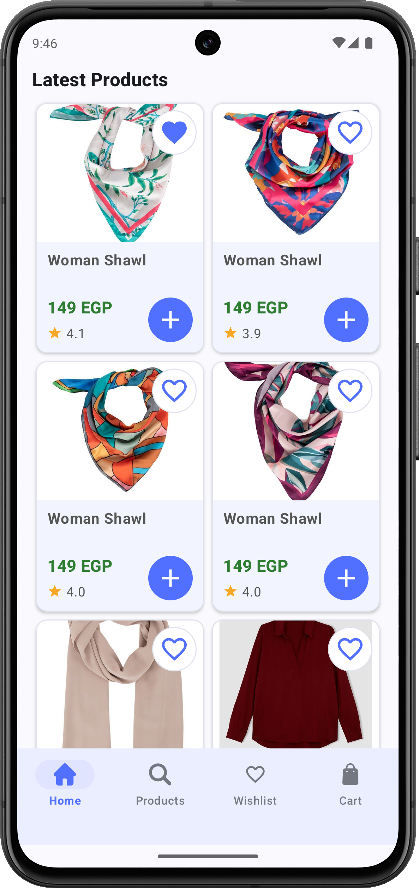
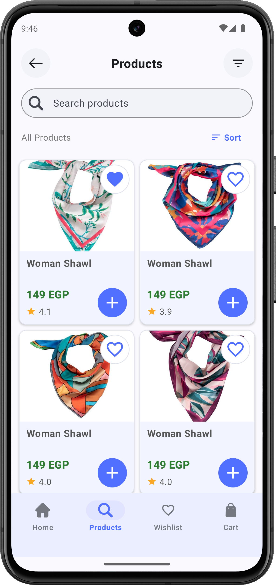
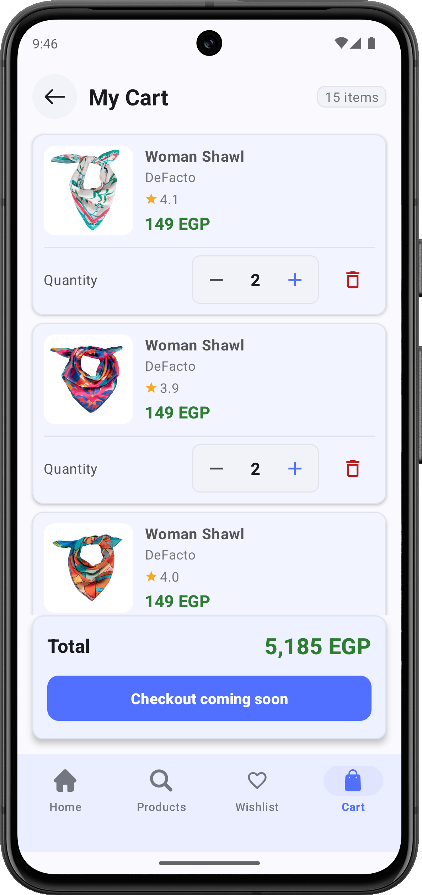
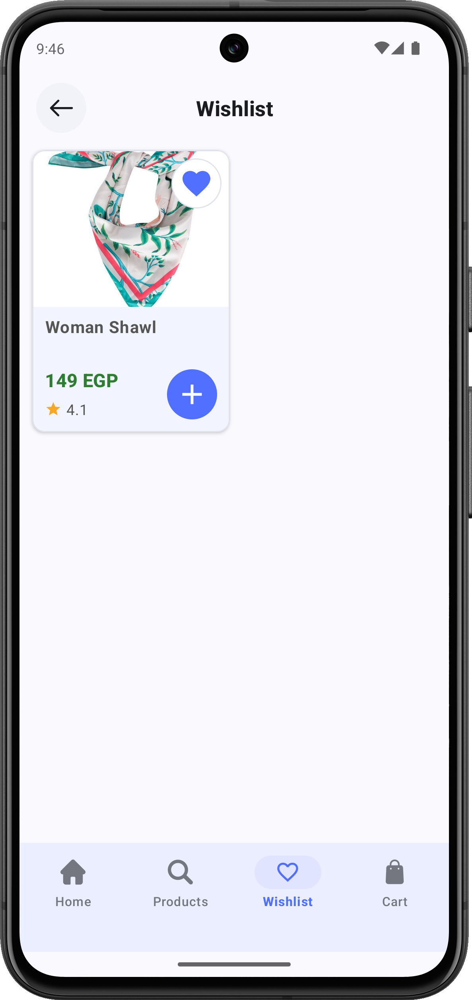

<p align="center">
  
</p>

<h1 align="center">E-Commerce App</h1>

<p align="center">
  A modern Android shopping application built with Kotlin, Material 3, and Clean Architecture.
</p>

<p align="center">
  
  
  
  
  
</p>

---

## 📱 Screenshots

### Authentication

| Sign In | Sign Up |
|:---:|:---:|
|  |  |

### Home

| Home - Categories & Brands | Home - Latest Products |
|:---:|:---:|
|  |  |

### Products, Cart & Wishlist

| Products | Cart | Wishlist |
|:---:|:---:|:---:|
|  |  |  |

---

## ✨ Features

### 🔐 Authentication
- **Sign In** — Log in with email and password, with input validation and password visibility toggle.
- **Sign Up** — Create an account with full name, email, phone number, and password confirmation.
- **Session Management** — Automatic token handling and persistent login state.

### 🏠 Home Screen
- **Search Bar** — Quickly search for products and brands.
- **Category Carousel** — Browse product categories with image sliders and paging indicators.
- **Brand Showcase** — Discover popular brands with "View All" navigation.
- **Latest Products** — Grid display of the newest products with prices, ratings, and favorite toggles.

### 🛍️ Products
- **Product Grid** — Browse all products in a clean two-column grid layout.
- **Search & Filter** — Search products by name and apply category/brand filters via a bottom sheet.
- **Sort Options** — Sort products by name, price (low to high / high to low), or rating.
- **Add to Cart** — One-tap add to cart directly from product cards.
- **Wishlist Toggle** — Tap the heart icon to save or remove products from your wishlist.

### 📦 Product Details
- **Image Gallery** — Swipeable image carousel for each product.
- **Product Info** — View name, brand, price, description, and average rating.
- **Quantity Selector** — Adjust item quantity before adding to cart.
- **Customer Reviews** — Read reviews with star ratings and user details.

### 🛒 Shopping Cart
- **Cart Items** — View all added products with thumbnails, brand, rating, and price.
- **Quantity Controls** — Increase or decrease item quantities with +/− buttons.
- **Remove Items** — Delete items from cart with undo support via Snackbar.
- **Order Summary** — Real-time total price calculation with item count badge.
- **Checkout** — Proceed to checkout (coming soon).

### ❤️ Wishlist
- **Saved Products** — View all favorited products in a dedicated wishlist screen.
- **Quick Actions** — Add wishlist items to cart or remove them.
- **Empty State** — Friendly empty state message when no items are saved.

### 🎨 Design & UX
- **Material 3 Design** — Consistent use of Material Design 3 components and theming.
- **Dark Mode** — Full dark theme support with proper color tokens.
- **Arabic Localization** — Complete Arabic (RTL) language support.
- **Responsive Layouts** — Adapts to different screen sizes and orientations.
- **Loading & Error States** — Skeleton shimmer loading and retry-on-error for all data screens.
- **Bottom Navigation** — Quick access to Home, Products, Wishlist, and Cart.

---

## 🏗️ Architecture & Tech Stack

| Layer | Technology |
|---|---|
| **Language** | Kotlin |
| **Architecture** | Clean Architecture (Data → Domain → Presentation) |
| **DI** | Hilt (Dagger) |
| **Networking** | Retrofit 3 + Gson |
| **Image Loading** | Glide 5 |
| **Navigation** | Jetpack Navigation Component + SafeArgs |
| **Async** | Kotlin Coroutines |
| **Local Storage** | Room Database |
| **View Binding** | Android View Binding |
| **UI** | Material 3 + XML Layouts |

---

## 📂 Project Structure

```
app/src/main/java/com/example/e_commerce/
├── core/                    # Utilities, DI modules, session & token management
│   ├── di/                  # Hilt modules (MyModule, TokenModule)
│   └── util/                # Formatters, NavigationExt, SingleLiveEvent
├── data/                    # Data layer — API services, repositories, models
│   ├── auth/                # Authentication API & repository
│   ├── brands/              # Brands API & repository
│   ├── cart_wishlist/        # Cart & Wishlist API & repositories
│   ├── category/            # Category API & repository
│   └── products/            # Products API & repository
├── domain/                  # Domain layer — business models
│   ├── brands/
│   ├── cart_wishlist/
│   ├── category/
│   └── products/
└── presentation/            # UI layer — Fragments, ViewModels, Adapters
    ├── auth/                # Splash, SignIn, SignUp
    ├── brands/              # BrandAdapter
    ├── cart_wishlist/        # Cart & Wishlist screens
    ├── category/            # CategoryAdapter
    ├── home/                # Home screen & container
    └── products/            # Products list, details, reviews, filters
```

---

## 🚀 Getting Started

### Prerequisites

- Android Studio Ladybug or later
- JDK 21
- Android SDK (API 37)

### Setup

1. **Clone the repository**
   ```bash
   git clone https://github.com/your-username/ECommerce.git
   cd ECommerce
   ```

2. **Open in Android Studio** and let Gradle sync.

3. **Run the app** on an emulator or physical device (min API 24).

---

## 📄 License

This project is for educational and demonstration purposes.

